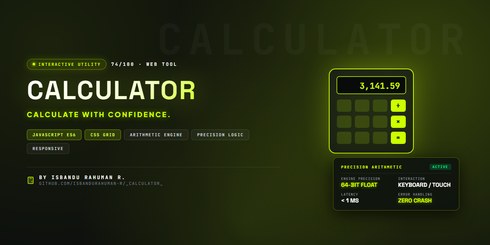

  

# Web Calculator

A simple and responsive Web Calculator developed using HTML, CSS, and JavaScript as part of the CodSoft Web Development Internship (Level 1 – Task 3).

## Features
- Perform basic arithmetic operations
- Clear and delete functionality
- Responsive design for different screen sizes
- User-friendly interface
- Real-time calculations

## Technologies Used
- HTML
- CSS
- JavaScript

## Project Preview
A clean and functional calculator designed to strengthen front-end development skills and JavaScript fundamentals.

## Internship Information
- Internship: CodSoft Web Development Internship
- Level: 1
- Task: 3 – Calculator

## Author
ISBANDU RAHUMAN R
