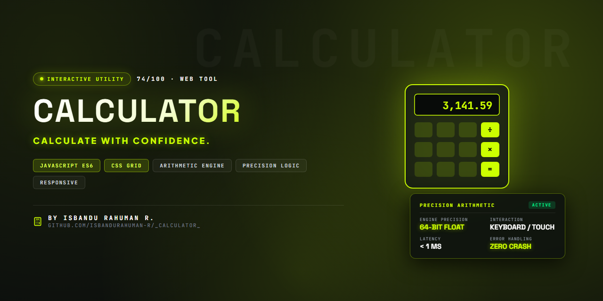
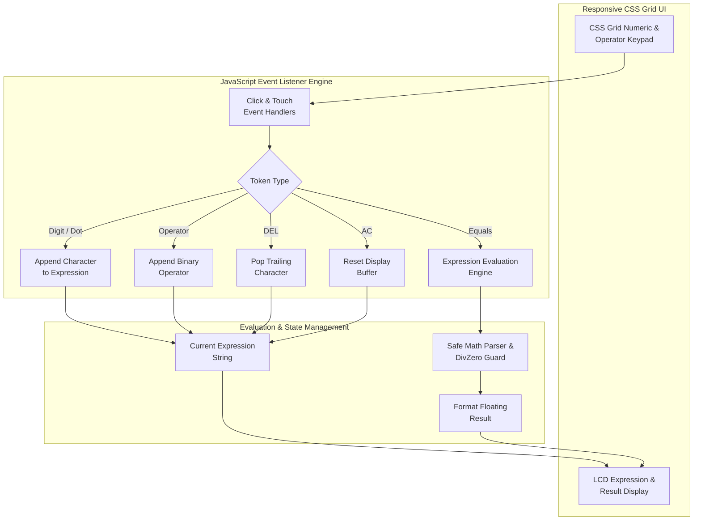

<p align="center">
  
</p>

# ◈ Web Calculator

[](https://github.com/ISBANDURAHUMAN-R/CODSOFT_taskno_CALCULATOR/actions/workflows/ci.yml)

## ◆ About the Project
Web Calculator is a responsive arithmetic calculator developed using HTML, CSS, and vanilla JavaScript. Created as part of the CodSoft Web Development Internship, it provides clean numerical computation across desktop and mobile screen sizes.

## ❖ Key Features
- Execution of core arithmetic operations (addition, subtraction, multiplication, division).
- Decimal input handling and mathematical expression evaluation.
- Clear screen (AC) and single-character delete functionality.
- Responsive CSS Grid keypad layout with active touch and click feedback.

## ◆ System Architecture


## ⬢ Technologies Used
- HTML5
- CSS3
- JavaScript (ES6)

## § Requirements
- Modern web browser

## ▲ Installation & Execution
```bash
# Open index.html directly or serve locally
python -m http.server 8000
```
Open `http://localhost:8000` in your web browser.

## ※ Developer
Developer: ISBANDU RAHUMAN R  
GitHub: https://github.com/ISBANDURAHUMAN-R
